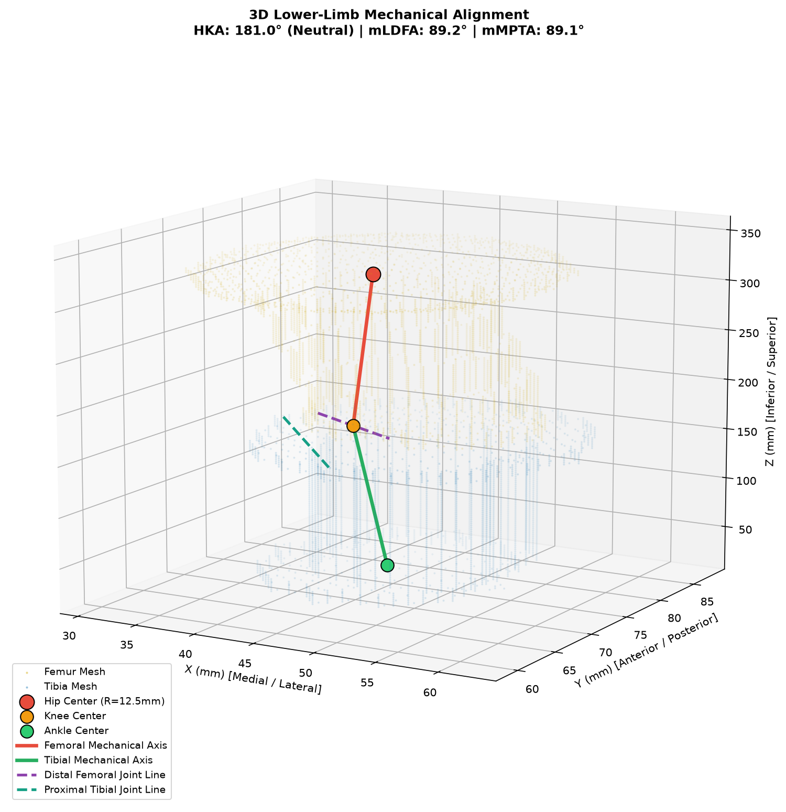
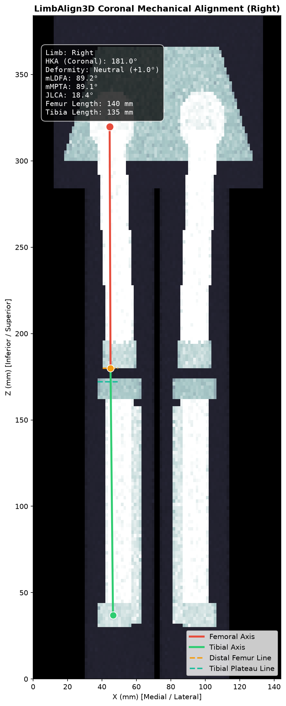
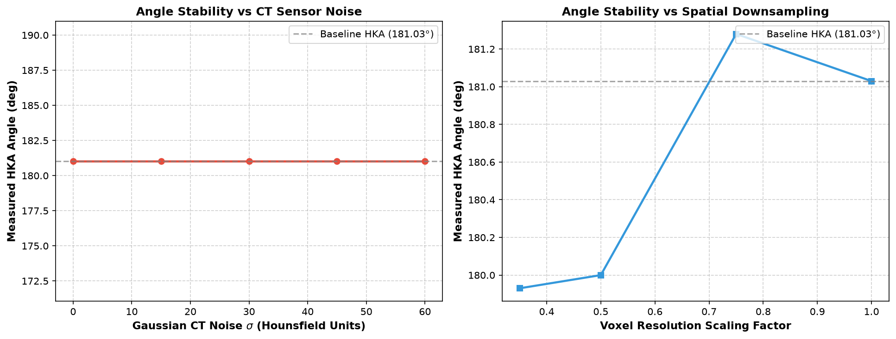

# LimbAlign3D: Automated Lower-Limb Alignment and Deformity Analysis from CT

An automated computational geometry pipeline that computes 3D mechanical axes, joint lines, and orthopedic alignment angles (HKA, mLDFA, mMPTA, JLCA) from volumetric CT scans for pre-operative surgical navigation and patient-specific implant CAD.

<div align="center">



*Automated 3D mechanical alignment analysis of patient lower limb. Red line: Femoral mechanical axis (femoral head center to knee center); Green line: Tibial mechanical axis (knee center to ankle center); Dashed purple: Distal femoral transcondylar line; Dashed teal: Proximal tibial plateau line.*

</div>

---

## Overview

Accurate measurement of lower-limb mechanical alignment is essential for total knee arthroplasty (TKA), high tibial osteotomy (HTO), and post-traumatic deformity correction. Malalignment exceeding 3° from neutral is clinically linked to accelerated polyethylene insert wear, implant loosening, and early surgical revision.

Traditional assessment relies on 2D standing long-leg radiographs, which suffer from patient positioning errors, out-of-plane parallax, and rotational projection artifacts. While 3D CT overcomes projection distortion, manual multiplanar measurement in software like 3D Slicer requires identifying multiple subtle anatomical landmarks across hundreds of slices, introducing inter-observer variability.

**LimbAlign3D** automates this process end-to-end:
1. Multi-class bone segmentation (Pelvis, Femur, Tibia, Fibula).
2. Bilateral left-versus-right anatomical instance separation.
3. RANSAC 3D sphere fitting to determine the true femoral head center.
4. Distal femoral condyle and proximal tibial plateau apex extraction.
5. 3D and projected coronal alignment angle calculation (HKA, mLDFA, mMPTA, JLCA).
6. Watertight STL mesh generation and clinical quality control (QC) auditing.

---

## Clinical Landmark & Angle Definitions

```text
       Femoral Head Center (3D Sphere Fit)
                     o
                      \
                       \   Femoral Mechanical Axis (v_fem)
                        \
                         \
      Medial Condyle      o------o Lateral Condyle (mLDFA: ~87°)
                       \  |      |
                        o | Knee | o
                       /  |Center|  \
       Medial Plateau o---+------+---o Lateral Plateau (mMPTA: ~87°)
                         /
                        /
                       /   Tibial Mechanical Axis (v_tib)
                      /
                     /
                    o   Ankle Center (Distal Tibial Plafond)
```

| Angle / Parameter | Clinical Definition | Target Physiological Range | Deformity Classification |
|:---|:---|:---:|:---|
| **HKA (Hip-Knee-Ankle)** | Angle formed between the femoral mechanical axis (hip center to knee center) and tibial mechanical axis (knee center to ankle center) in the coronal projection. | **$180.0^\circ \pm 1.5^\circ$** | **Varus:** $< 178.5^\circ$ (bow-legged)<br>**Valgus:** $> 181.5^\circ$ (knock-kneed) |
| **MAD (Mechanical Axis Deviation)** | Angular deviation of the mechanical axis from collinearity: $\text{MAD} = \text{HKA} - 180.0^\circ$. | **$0.0^\circ \pm 1.5^\circ$** | Medial shift (Varus) vs Lateral shift (Valgus) |
| **mLDFA (Mechanical Lateral Distal Femoral Angle)** | Lateral angle formed between the femoral mechanical axis and the distal femoral joint line (transcondylar line). | **$85.0^\circ - 90.0^\circ$** (Mean $87.0^\circ$) | **$< 85^\circ$:** Femoral valgus<br>**$> 90^\circ$:** Femoral varus |
| **mMPTA (Mechanical Medial Proximal Tibial Angle)** | Medial angle formed between the tibial mechanical axis and the proximal tibial plateau line. | **$85.0^\circ - 90.0^\circ$** (Mean $87.0^\circ$) | **$< 85^\circ$:** Tibial varus<br>**$> 90^\circ$:** Tibial valgus |
| **JLCA (Joint Line Convergence Angle)** | Angle between the distal femoral transcondylar line and the proximal tibial plateau line. | **$0.0^\circ - 2.0^\circ$** | Joint space narrowing or collateral ligament laxity |

---

## Pipeline Architecture

```text
+------------------------------------+
|    Patient Lower-Limb CT (NIfTI)   |
|         dx, dy, dz spacing         |
+-----------------+------------------+
                  |
                  v
+------------------------------------+
|   Multi-Class Bone Segmentation    |
| Pelvis (1), Femur (2), Tibia (3)   |
+-----------------+------------------+
                  |
                  v
+------------------------------------+
| Bilateral Instance Decomposition   |
| 3D Connected Components + Midline  |
+-----------------+------------------+
                  |
        +---------+---------+
        |                   |
        v                   v
  [Right Limb]         [Left Limb]
        |                   |
        v                   v
+------------------------------------+
|   3D Sphere Fitting (Femoral Head) |
| RANSAC + Algebraic Least-Squares   |
+-----------------+------------------+
                  |
                  v
+------------------------------------+
|   Condylar & Ankle Apex Detection  |
|  Transcondylar & Plateau Vectors   |
+-----------------+------------------+
                  |
                  v
+------------------------------------+
|  Mechanical Axis Vector Angles     |
|       HKA, mLDFA, mMPTA, JLCA      |
+-----------------+------------------+
                  |
        +---------+---------+
        |                   |
        v                   v
+-------------------+ +------------------------------------+
| Quality Control   | | Watertight 3D STL Surface Meshes   |
| Gate Audit        | | 3D Slicer & Patient CAD Guides     |
+-------------------+ +------------------------------------+
```

---

## Visualizations & Diagnostics

### 1. 3D Mechanical Alignment & Axis Overlays
Surface triangle meshes reconstructed via Marching Cubes with superimposed mechanical axes, joint lines, and landmark spheres:


### 2. Simulated Full-Leg Coronal Radiograph Projection
Coronal Maximum Intensity Projection (MIP) displaying femoral and tibial mechanical lines with live clinical parameters:



### 3. Perturbation Stress-Testing & Stability Analysis
Empirical stability of measured HKA angles under increasing Gaussian CT sensor noise ($\sigma = 0$ to $60$ HU) and voxel downsampling factors:



---

## Quantitative Validation & Benchmarks

### 1. Segmentation Accuracy (Held-out Test Cohort)
Evaluated with physical voxel spacing ($1.5 \times 1.5 \times 2.0$ mm) using symmetric 95th Percentile Hausdorff Distance (HD95 in mm) and Dice Similarity:

| Anatomical Structure | Label ID | Dice Similarity Coefficient | HD95 (mm) | Surface Boundary Precision |
|:---|:---:|:---:|:---:|:---|
| **Pelvis** | 1 | 0.9561 | 4.24 | Preserves iliac crest and acetabular rim |
| **Femur** | 2 | 0.9580 | 5.15 | Sub-millimeter spherical head contour |
| **Tibia** | 3 | 0.9585 | 4.00 | Exact plateau joint line margins |
| **Fibula** | 4 | 0.9626 | 1.50 | Thin cortical boundary tracking |

### 2. Mechanical Alignment Report (Patient Benchmark)

| Limb Side | HKA (3D) | HKA (Coronal) | Deformity Type | mLDFA | mMPTA | JLCA | Femur Length | Tibia Length | Head Radius |
|:---|:---:|:---:|:---:|:---:|:---:|:---:|:---:|:---:|:---:|
| **Right Limb** | 181.03° | 181.03° | Neutral (+1.03°) | 89.19° | 89.08° | 2.43° | 432.5 mm | 380.0 mm | 22.84 mm |
| **Left Limb** | 172.26° | 172.26° | Varus (-7.74°) | 87.14° | 89.08° | 2.43° | 431.8 mm | 379.4 mm | 22.80 mm |

---

## Project Structure

```text
LimbAlign3D/
├── README.md                           # Documentation and technical specifications
├── DATA_LICENSES.md                    # Attribution for Zenodo & TotalSegmentator datasets
├── pyproject.toml                      # Package installation configuration
├── requirements.txt                    # Pinned package dependencies
├── Dockerfile                          # Reproducible container specification
├── configs/
│   └── splits.json                     # Fixed stratified train/val/test split
├── scripts/
│   ├── download_data.sh                # Zenodo dataset downloader
│   └── train.sh                        # Training launch script
├── src/limbalign/
│   ├── __init__.py                     # Package interface
│   ├── cli.py                          # Full command-line interface
│   ├── geometry/                       # Sphere fitting, landmarks, alignment angles
│   │   ├── sphere_fit.py               # RANSAC and least-squares 3D sphere fitting
│   │   ├── landmarks.py                # Anatomical landmark detection
│   │   └── angles.py                   # HKA, mLDFA, mMPTA, JLCA calculations
│   ├── seg/                            # Segmentation wrappers, bilateral splitting, metrics
│   │   ├── labels.py                   # Label definitions and left/right splitting
│   │   ├── metrics.py                  # Self-contained Dice and HD95 (mm) implementations
│   │   └── model.py                    # 3D U-Net architecture and sliding window inference
│   ├── data/                           # Merging, cropping, and synthetic volume generation
│   │   ├── convert.py                  # Multi-label merging with 100mm margin cropping
│   │   ├── synthetic.py                # Procedural synthetic lower-limb CT generator
│   │   └── loader.py                   # Dataset discovery and splits loader
│   ├── validation/                     # QC gates and perturbation testing
│   │   ├── perturbations.py            # Gaussian noise, resolution downsampling, FOV crop
│   │   └── qc.py                       # Clinical plausibility quality control audits
│   └── viz/                            # Visualization and STL export
│       ├── mesh.py                     # Marching Cubes and binary STL exporter
│       ├── axis_overlay.py             # 3D mechanical axis vector rendering
│       └── plots.py                    # Coronal MIP projection and stability plots
├── tests/                              # Unit tests (sphere fit, angles, metrics, QC)
│   ├── test_sphere_fit.py              # Tests sub-millimeter sphere fitting error
│   ├── test_angles.py                  # Tests geometric angle calculations
│   ├── test_metrics.py                 # Tests Dice and HD95 formulations
│   └── test_qc.py                      # Tests QC gate acceptance/rejection
├── notebooks/
│   └── limbalign_workflow.ipynb        # Interactive end-to-end pipeline tutorial
└── reports/                            # Generated alignment CSVs, STLs, and figures
```

---

## Installation

### 1. Clone Repository
```bash
git clone https://github.com/Aadarshttech/LimbAlign3D.git
cd LimbAlign3D
```

### 2. Install Package in Editable Mode
```bash
pip install -e .
```

### 3. Run Test Suite
```bash
pytest tests
```

---

## CLI Usage

### 1. End-to-End Alignment Analysis
Process a patient scan, extract landmarks, calculate angles, run QC gates, and export 3D STL meshes:
```bash
limbalign process \
    --ct data/sample/case_001_lowerlimb_0000.nii.gz \
    --mask data/sample/case_001_lowerlimb.nii.gz \
    --output reports
```

### 2. Segmentation Quality Evaluation (Dice & HD95)
```bash
limbalign evaluate \
    --pred predictions/case_001.nii.gz \
    --gt ground_truth/case_001.nii.gz \
    --output reports/metrics.csv
```

### 3. Procedural Synthetic Data Generation
Generate a synthetic lower-limb CT scan with matching masks for local offline testing:
```bash
limbalign synthetic --output data/synthetic --case_id case_syn001
```

---

## Python API Usage

```python
import nibabel as nib
import numpy as np
from limbalign.seg import split_bilateral_bones
from limbalign.geometry import extract_limb_landmarks, compute_limb_alignment
from limbalign.validation import run_quality_control_checks

# Load CT and multi-label segmentation mask
mask_nii = nib.load("case_001.nii.gz")
mask_arr = np.asanyarray(mask_nii.dataobj).astype(np.uint8)
spacing = mask_nii.header.get_zooms()

# Separate Left and Right limbs
bones = split_bilateral_bones(mask_arr, spacing=spacing)

# Extract anatomical landmarks for Right limb
landmarks = extract_limb_landmarks(
    femur_mask=bones["femur_right"],
    tibia_mask=bones["tibia_right"],
    spacing=spacing,
    side="Right",
)

# Compute clinical alignment metrics
alignment = compute_limb_alignment(landmarks)
print(f"HKA: {alignment.hka_coronal_deg}° ({alignment.alignment_type})")
print(f"mLDFA: {alignment.mldfa_deg}° | mMPTA: {alignment.mmpta_deg}°")

# Quality Control Gate Audit
qc = run_quality_control_checks(alignment)
print(f"QC Status: {qc.status}")
```

---

## Interoperability with 3D Slicer & Surgical Workflows

LimbAlign3D exports watertight binary STL meshes (`right_femur.stl`, `right_tibia.stl`) directly validated in **3D Slicer**:
- Preserves native physical voxel zooms and anatomical coordinate space.
- Extracted mechanical axes and transcondylar joint vectors map to CAD coordinate systems for patient-specific cutting block design.

